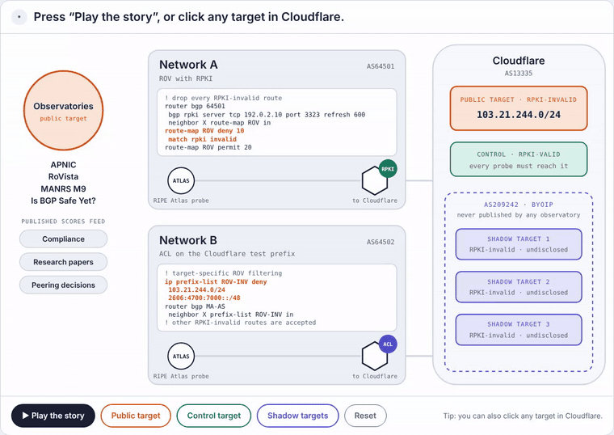

# The Observer Effect in Internet Measurement: A Case Study of Route Origin Validation

Abbas Mohsenpour and Cristel Pelsser (UCLouvain) · HotNets '26 · [DOI 10.1145/3847290.3859951](https://doi.org/10.1145/3847290.3859951)

## ▶ Interactive lab

Can a network treat a well-known measurement target differently from an equivalent one that nobody knows? **[Open the lab](https://abbasmp17.github.io/measurement-awareness-rov/)** to play it yourself.

## Contents

- `hotnets26/`: paper sources and PDF
- `dataset/`: RIPE Atlas measurement IDs and RoVista test-prefix snapshots
- `scripts/`: scripts to reproduce Figures 2 and 3
- `index.html`: the interactive lab
